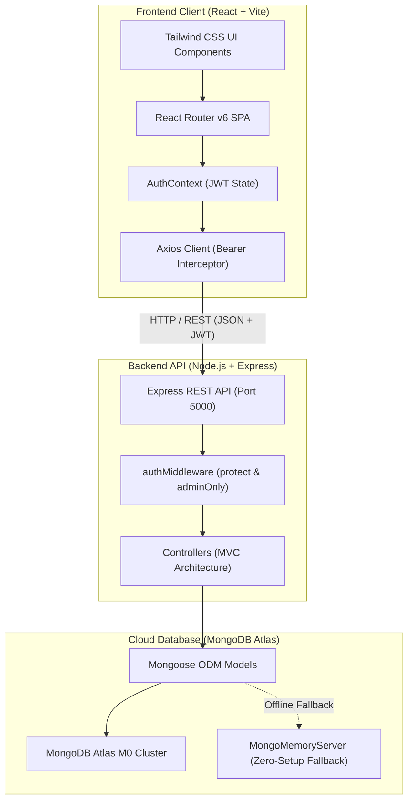

<div align="center">

# 🎓 Campus Connect
### *A Centralized, Modern Web Ecosystem for College Students & Faculty*

[](https://react.dev/)
[](https://vitejs.dev/)
[](https://tailwindcss.com/)
[](https://nodejs.org/)
[](https://expressjs.com/)
[](https://www.mongodb.com/)
[](https://jwt.io/)
[](https://opensource.org/licenses/ISC)

<br/>

**Campus Connect** is a full-stack MERN web application engineered to bridge communication gaps in universities. It centralizes academic resource sharing, lost-and-found recovery, peer discussions, and official administrative announcements into a single responsive portal.

[Explore Features](#-key-features) • [System Architecture](#-system-architecture) • [API Documentation](#-rest-api-documentation) • [Installation](#-quick-start) • [Live Demo](#-evaluator-demo-credentials)

</div>

---

## 👩‍💻 Lead Developer & Team

- **Lead Full-Stack Developer:** **Soumya Chaudhary** (*B.Tech CSE, 2nd Year*)
- **Department:** Computer Science & Engineering
- **Project Domain:** Web Engineering, Cloud Database & Distributed Systems
- **Project Type:** College CSE Mini-Project 2026

---

## 🌟 Key Features

### 1. 📚 Academic Resource Library
- **Categorized Study Materials:** Access semester-wise Notes, Previous Year Question Papers (PYQs), Lab Manuals, Assignments, and Reference Books.
- **Advanced Filtering & Search:** Real-time multi-filter by Branch (CSE, IT, ECE, MECH, etc.), Semester (1 to 8), and Resource Type with case-insensitive search.
- **Direct Uploads:** Upload study PDFs and documents straight from your device with automatic file-size calculation and download triggers.

### 2. 🔎 Campus Lost & Found Tracker
- **Instant Reporting:** Report misplaced belongings or discovered campus items with location, date, category tag, and contact details.
- **Device Photo Attachments:** Attach real item photos directly from your phone or PC with instant thumbnail preview.
- **Lifecycle Management:** 1-Click *"Mark Resolved"* status toggle that updates the listing status across the network.

### 3. 🧑‍🤝‍🧑 Student Community Discussion Feed
- **Campus Forum:** Share technical queries, hackathon partner requests, and campus event discussions.
- **Rich Media & Tags:** Support for photo uploads and category badges (`Academics`, `Opportunities`, `Clubs`, `Help`, `Events`).
- **Interactive Engagement:** Real-time Like/Unlike counters and collapsible threaded comments.

### 4. 📢 Official Department Circulars & Admin Hub
- **Administrative Control Panel:** Role-based dashboard exclusive to faculty and administrators (`/admin/updates`).
- **Official Publishing:** Post examination timetables, workshop registrations, and scholarship circulars with official document attachments.
- **Full CRUD Support:** Real-time edit and delete controls for administrators.

### 5. 🧑‍🎓 Student Profile & Academic Portfolio
- **Credential Badges:** Displays student's full name, college email, branch, academic year, section, bio, and technical interests.
- **Activity Tracker:** Tabbed overview organizing *"My Uploaded Resources"*, *"My Lost & Found Listings"*, and *"My Community Posts"*.
- **Avatar Customization:** Upload custom profile avatars with instant client-side preview.

---

## 🏗️ System Architecture



---

## 🛠️ Technology Stack & Rationale

| Layer | Technology | Engineering Rationale |
|---|---|---|
| **Frontend** | React 18 (Vite) | Lightning-fast Hot Module Replacement (HMR), component modularity, and optimized production bundle chunking. |
| **Styling** | Tailwind CSS | Utility-first, mobile-responsive CSS framework delivering a clean, modern college interface with zero bloat. |
| **Icons** | Lucide React | Modern, consistent iconography for student utilities and status indicators. |
| **Routing** | React Router v6 | Client-side Single Page Application (SPA) routing with `ProtectedRoute` and `AdminRoute` guards. |
| **Backend** | Node.js & Express.js | Asynchronous, event-driven REST API architecture for high throughput. |
| **Database** | MongoDB Atlas | Cloud-hosted NoSQL document database providing dynamic schemas and relational population (`ObjectId` references). |
| **Authentication** | JWT & bcryptjs | Stateless authorization with signed bearer tokens and salted password hashing (`salt rounds: 10`). |
| **File Handling** | FileReader (Base64) | Direct browser-to-server data encoding with live thumbnail previews and cross-device support. |

---

## 📡 REST API Documentation

### 🔐 Authentication & Users
| Method | Endpoint | Access | Description |
|---|---|---|---|
| `POST` | `/api/auth/register` | Public | Register new student with name, email, password, branch, year, section |
| `POST` | `/api/auth/login` | Public | Authenticate user & return signed JWT token |
| `GET` | `/api/auth/me` | Private | Retrieve authenticated student profile |
| `PUT` | `/api/users/profile` | Private | Update student bio, interests, avatar, and academic details |

### 📚 Academic Resources
| Method | Endpoint | Access | Description |
|---|---|---|---|
| `GET` | `/api/resources` | Public | Query study resources with search, branch, semester & type filters |
| `POST` | `/api/resources` | Private | Upload notes, PYQs, or lab manuals with document attachment |
| `DELETE` | `/api/resources/:id` | Private (Owner/Admin) | Delete academic resource |

### 🔎 Lost & Found
| Method | Endpoint | Access | Description |
|---|---|---|---|
| `GET` | `/api/lost-found` | Public | List lost/found items with category and status filters |
| `POST` | `/api/lost-found` | Private | Report misplaced or discovered item with image attachment |
| `PUT` | `/api/lost-found/:id` | Private (Owner/Admin) | Toggle status (`Active` / `Resolved`) |
| `DELETE` | `/api/lost-found/:id` | Private (Owner/Admin) | Delete item listing |

### 🧑‍🤝‍🧑 Community Feed
| Method | Endpoint | Access | Description |
|---|---|---|---|
| `GET` | `/api/posts` | Public | Fetch community feed filtered by category |
| `POST` | `/api/posts` | Private | Create discussion post with optional photo |
| `POST` | `/api/posts/:id/like` | Private | Toggle Like / Unlike counter |
| `POST` | `/api/posts/:id/comments` | Private | Add comment to post thread |
| `DELETE` | `/api/posts/:id` | Private (Author/Admin) | Delete post |

### 📢 Official Updates & Admin Operations
| Method | Endpoint | Access | Description |
|---|---|---|---|
| `GET` | `/api/updates` | Public | Fetch department notices, workshops, and hackathons |
| `POST` | `/api/admin/updates` | Private (Admin only) | Publish official university circular |
| `PUT` | `/api/admin/updates/:id` | Private (Admin only) | Update circular details or dates |
| `DELETE` | `/api/admin/updates/:id` | Private (Admin only) | Remove official notice |

---

## 🔑 Evaluator Demo Credentials

The cloud database is pre-seeded with test accounts for instant evaluation:

| Role | Email | Password | Pre-loaded Profile |
|---|---|---|---|
| **Student (Lead)** | `student@college.edu` | `student123` | **Soumya Chaudhary** (*CSE • 2nd Year, Sec A*) |
| **Faculty / Admin** | `admin@college.edu` | `admin123` | **Dr. S. K. Sharma** (*HOD CSE • Administrator*) |

> 💡 *The `/login` screen also includes **1-Click "Student Account"** and **"Admin Account"** buttons for effortless testing during viva demonstrations!*

---

## 🚀 Quick Start (Local Setup)

### 1. Clone Repository
```bash
git clone https://github.com/your-username/campus-connect.git
cd campus-connect
```

### 2. Backend Setup
```bash
cd server
npm install
```
Configure your environment variables in `server/.env`:
```env
PORT=5000
NODE_ENV=development
MONGO_URI=your_mongodb_atlas_connection_string
JWT_SECRET=super_secret_jwt_key_campus_connect_2026
CLIENT_URL=http://localhost:5175
```
Start backend:
```bash
node server.js
```

### 3. Frontend Setup
In a separate terminal:
```bash
cd client
npm install
npm run dev
```
Open **`http://localhost:5175`** in your browser!

---

## 🔒 Security Implementations

1. **Password Hashing:** Passwords are never stored in plain text. Pre-save Mongoose middleware hashes passwords using `bcryptjs` with 10 salt rounds.
2. **Stateless JWT Tokens:** Authentication sessions are validated using HMAC-SHA256 signed JSON Web Tokens expiring in 30 days.
3. **Route Guards:** Two levels of authorization middleware (`protect` and `adminOnly`) intercept requests before hitting controller handlers.
4. **Environment Isolation:** Secrets, database passwords, and private keys are excluded from git tracking via `.gitignore`.
5. **NoSQL Injection & XSS Protection:** Mongoose schema validations sanitize inputs and query parameters before reaching database engines.

---

## 📜 License

This project is licensed under the **ISC License**. Developed as an academic mini-project by CSE students.

---

<div align="center">
  <sub>Built with ❤️ by <b>Soumya Chaudhary</b> & CSE Mini Project Team • 2026</sub>
</div>
